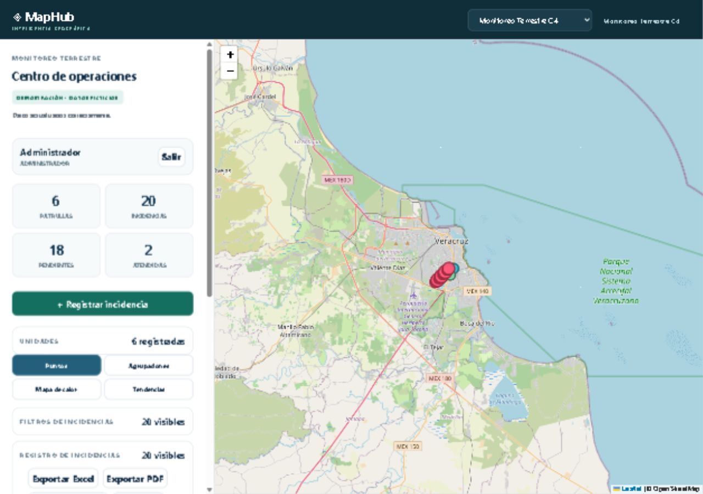

# Portafolio de trabajo · Nicolás Caballero

Proyectos de desarrollo web, sistemas geográficos y automatización de audio.
Cada carpeta incluye código e instrucciones de instalación. Son aplicaciones
con servidor propio: GitHub aloja el código, no ejecuta PHP, PostgreSQL ni Python.

| Proyecto | Qué resuelve | Tecnologías |
|---|---|---|
| [Quantum](proyectos/quantum) | Publicación editorial y administración de contenidos | PHP, MySQL, JavaScript, PWA |
| [MapHub](proyectos/maphub) | Registro y atención de incidencias con patrullas en un mapa | Vue 3, Leaflet, PHP, PostgreSQL/PostGIS |
| [Transcriptor de audios](proyectos/transcriptor) | Conversión local de audio a texto y subtítulos | Python, faster-whisper |

## MapHub

Panel adaptable con mapa, filtros, unidades, historial, gráficas y exportación.
El modo de demostración está identificado y utiliza incidencias ficticias.
La integración con equipos GPS reales requiere configurar un proveedor.

## Alcance de esta entrega

- Código y esquemas de instalación, sin contraseñas, respaldos, audios privados ni publicaciones de usuarios.
- MapHub: flujo crear, asignar, resolver y consultar historial verificado con una base aislada; control de duplicados y permisos.
- Quantum: revisión de sintaxis PHP; esta copia no incluye contenido editorial ni una base de producción.
- Transcriptor: pruebas de exportación TXT, JSON y SRT; no se incluyen grabaciones privadas ni modelos descargados.

Los nombres y recursos institucionales conservados pertenecen a sus respectivos titulares.
Este repositorio presenta trabajo técnico y no implica una publicación institucional oficial.
Las dependencias conservan sus licencias originales.
